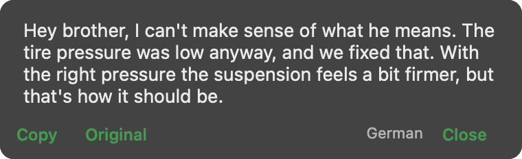
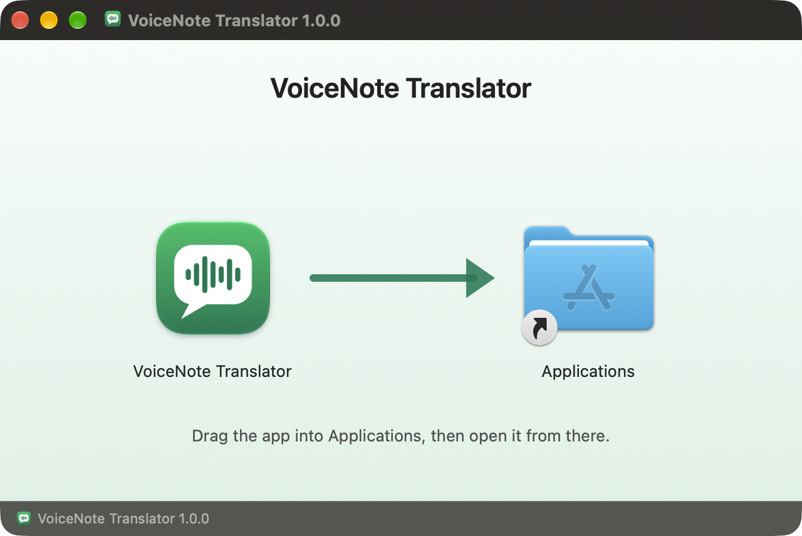
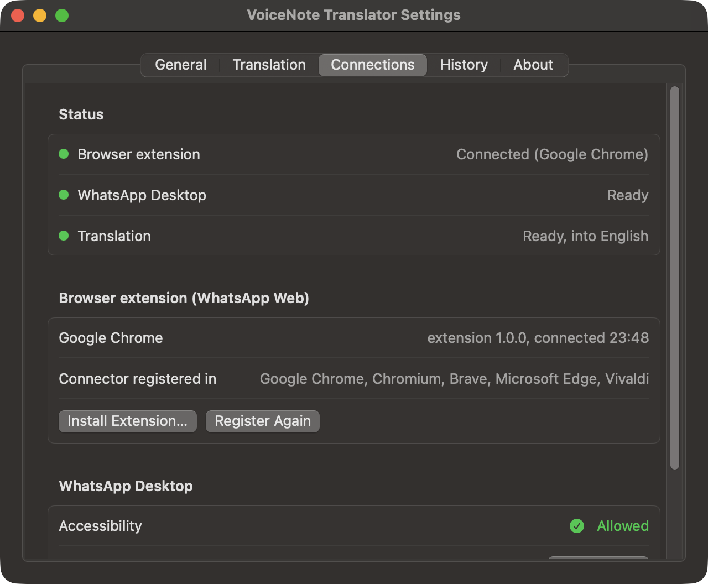
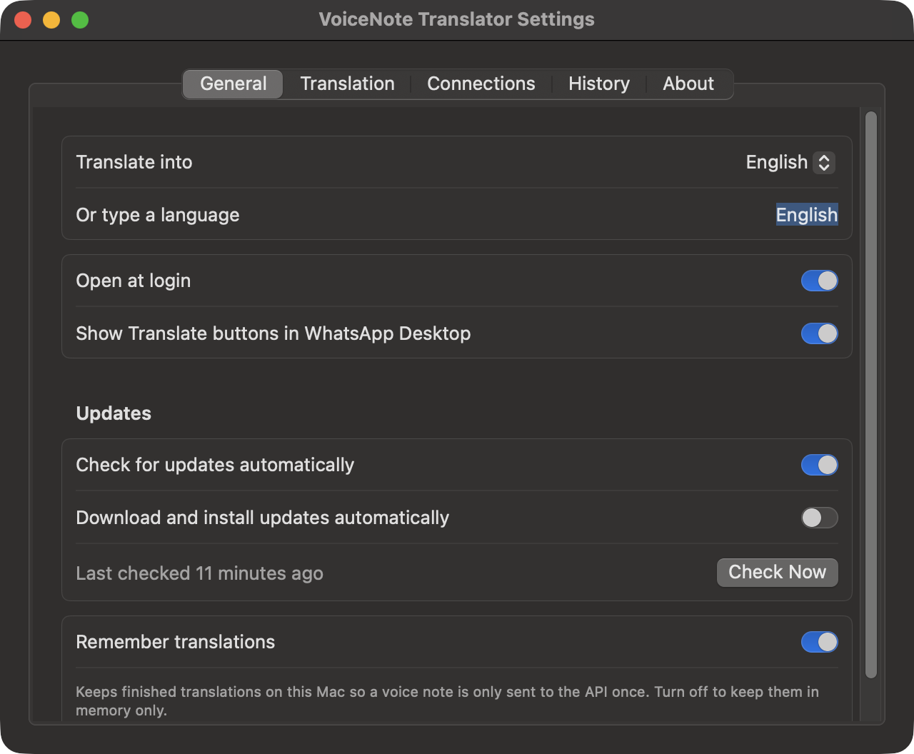
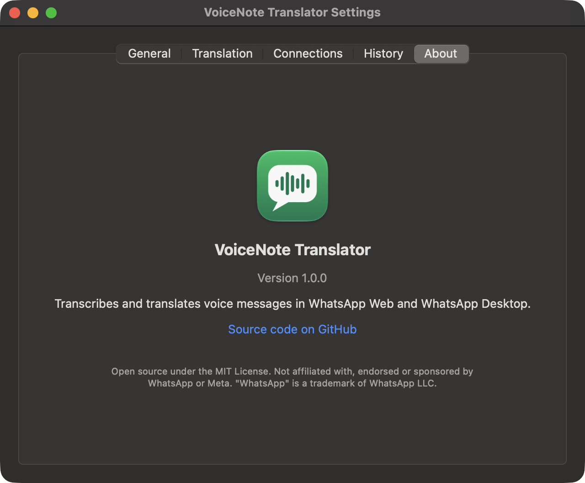

<p align="center">
  
</p>

<h1 align="center">VoiceNote Translator</h1>

<p align="center">
  <b>Transcribe and translate WhatsApp voice messages on your Mac, with one click.</b><br>
  Works in WhatsApp Web (Chrome, Brave, Edge, Arc…) and in the WhatsApp Desktop app.
</p>

<p align="center">
  <a href="../../releases/latest">Download</a> ·
  <a href="#install">Install</a> ·
  <a href="#how-it-works">How it works</a> ·
  <a href="#privacy">Privacy</a> ·
  <a href="#build-from-source">Build from source</a>
</p>

---

Someone sends you a two-minute voice note in a language you don't speak. Click **Translate** next to it, and a few seconds later you read what they said, in clear English (or any language you pick), with the original transcript one click away.

<p align="center">
  
  &nbsp;→&nbsp;
  
</p>

## Features

- **One click, right in WhatsApp.** A *Translate* button appears next to every voice message, in WhatsApp Web and WhatsApp Desktop. Translated notes turn into a small  icon you can open again any time.
- **Reads like a person wrote it.** Speech-to-text (Whisper) followed by a language model that rewrites the transcript as clear, natural text in the speaker's own voice, keeping every point, names and numbers. Unclear bits are marked `[unclear]` instead of guessed.
- **Any language.** English, German, Arabic, Spanish… or "Simple English". Switch from the menu bar.
- **Paid for once.** Every note is sent to the API only once; results are cached and kept in a searchable history.
- **A real Mac app.** Menu bar icon with live connection status, a Settings window, open at login, a drag-and-drop installer.
- **Private by design.** Your API key lives in the macOS Keychain. The browser extension never sees it and has no network access at all. No telemetry.
- **Bring your own model.** [OpenRouter](https://openrouter.ai) by default (Whisper Large V3 Turbo + Claude Haiku 5.5), or any OpenAI-compatible API.
- **Updates itself.** Checks for new versions daily and installs them in one click (or silently, if you prefer). The browser extension updates along with the app.
- **Light on resources.** The WhatsApp Desktop buttons cost about 1–2% CPU while WhatsApp is in front, and nothing while it's in the background.

## Install

Requires **macOS 14 Sonoma or later** and an API key from [OpenRouter](https://openrouter.ai/keys) (or another OpenAI-compatible provider).

1. Download **`VoiceNote-Translator-<version>.dmg`** from the [latest release](../../releases/latest).
2. Open it and drag **VoiceNote Translator** into **Applications**.

   

3. Open VoiceNote Translator from Applications. A waveform icon appears in the menu bar and Settings opens.

> Releases are signed with a Developer ID and notarized by Apple, so they open without warnings. **Built it yourself and see "Apple could not verify…"?** Builds that aren't notarized show this once. Click **Done**, then open System Settings → Privacy & Security, scroll down and click **Open Anyway** next to VoiceNote Translator (on macOS 14 you can also right-click the app → **Open**). Or run `xattr -dr com.apple.quarantine "/Applications/VoiceNote Translator.app"` once.

### Set it up (two minutes)

**1. Add your API key.** Settings → **Translation** → paste the key → **Save** → **Test connection**.

**2. WhatsApp Web.** Settings → **Connections** → **Install Extension…**, then in Chrome:
   1. open `chrome://extensions` and turn on **Developer mode** (top right),
   2. click **Load unpacked** and choose the *Browser Extension* folder that just opened in Finder,
   3. open [web.whatsapp.com](https://web.whatsapp.com).

   The same works in Brave, Edge, Arc, Vivaldi and other Chromium browsers.

**3. WhatsApp Desktop.** Settings → **Connections** → **Allow…** next to *Accessibility*, and turn VoiceNote Translator on. The first time you translate there, macOS asks whether the app may read another app's data: choose **Allow**.

<p align="center">
  
</p>

When the menu bar icon shows three green dots (browser extension, WhatsApp Desktop, translation), you're done. VoiceNote Translator opens at login from now on; turn that off in Settings → General.

## Using it

| Where | What to do |
|---|---|
| **WhatsApp Web** | Click **Translate** under a voice message. The translation appears under it, with **Copy** and **Original**. Click the  icon to hide or show it again. |
| **WhatsApp Desktop** | Click **Translate** beside a voice bubble. The translation opens in a small panel with **Copy**, **Original** and **Close**. Keyboard: **Esc** closes, **⌘C** copies, **Tab** shows the original. |
| **Menu bar** | See what's connected, switch the target language, turn the WhatsApp Desktop buttons on or off, open recent translations, check for updates. When an update is out, the icon changes to <b>↓</b> and the menu shows **Update to … Available**. |
| **Settings → History** | Search everything you've translated, copy the translation or the original, delete entries. |

You don't hear anything when you click Translate: on WhatsApp Web the note is loaded silently, and on WhatsApp Desktop the app reads the file WhatsApp already downloaded.

<p align="center">
  
  
</p>

## How it works

```
┌──────────────── WhatsApp Web ────────────────┐      ┌── WhatsApp Desktop ──┐
│ Translate button → extension (connector only)│      │  Translate button    │
└───────────────────────┬──────────────────────┘      └──────────┬───────────┘
          Chrome native messaging (vnt-host)                     │ Accessibility (read-only)
                        ▼                                        ▼
            ┌──────────────── VoiceNote Translator.app ────────────────┐
            │ menu bar · settings · history · Keychain · cache          │
            └────────────────────────────┬─────────────────────────────┘
                                         ▼
                 speech-to-text + translation (OpenRouter or OpenAI-compatible)
```

**WhatsApp Web.** The extension catches the voice note's audio at the moment WhatsApp decodes it for playback, so nothing is downloaded twice. It hands the audio to the app through Chrome's [native messaging](https://developer.chrome.com/docs/extensions/develop/concepts/native-messaging): Chrome starts `vnt-host` (inside the app bundle), which relays messages to the app over a private Unix socket. Only this extension's ID may connect. The connector stays up while the app restarts and reconnects on its own. Message format: [docs/PROTOCOL.md](docs/PROTOCOL.md).

**WhatsApp Desktop.** WhatsApp for Mac has no plugin system, and VoiceNote Translator never modifies or injects into it. Instead it reads the open chat through macOS Accessibility (read-only), floats its buttons beside the voice bubbles, and finds each note's audio file through WhatsApp's local database (read-only). It only checks the window while WhatsApp is the front app, using a cheap three-query check and a full read only when something moved.

**Translation.** The audio goes to the speech-to-text model; the transcript then goes to a chat model with instructions to translate and reword it in the speaker's voice. The result is cached by audio fingerprint and target language.

## Permissions

| Permission | Why | When |
|---|---|---|
| **Accessibility** | To see the open WhatsApp Desktop chat and place the buttons. Read-only. | Only for WhatsApp Desktop |
| **Access to other apps' data** | To read the voice note files WhatsApp Desktop already saved. Read-only. | Asked the first time you translate in WhatsApp Desktop |
| **Login item** | To be running when you open WhatsApp. | On by default; Settings → General |
| Browser extension: `nativeMessaging`, `web.whatsapp.com` | To talk to the app and add buttons to WhatsApp Web. No other sites, no network access. | When you install the extension |

## Privacy

- Audio and transcripts go **only** to the API you configure. No analytics, no telemetry, no accounts.
- Once a day the app asks GitHub for this project's update feed (turn it off in Settings → General → Updates). No information about you or your Mac is sent with it.
- The API key is stored in the macOS Keychain (or read from a key file you choose). The extension never receives it.
- History is kept in `~/Library/Application Support/VoiceNote Translator/history.json`. Turn off *Remember translations* to keep it in memory only, or clear it in Settings → History.
- Your provider's own data policy applies to what you send it. OpenRouter lets you restrict providers that train on data in your account settings.

## Cost

With the defaults on OpenRouter, a one-minute voice note costs a fraction of a cent: Whisper is billed per minute of audio, and the rewording uses a few hundred tokens of a small model. Opening a note again is free.

## Settings reference

| Setting | Default | Notes |
|---|---|---|
| Translate into | English | Any language name; also in the menu bar |
| Open at login | On | |
| Check for updates automatically | On | Once a day |
| Download and install updates automatically | Off | Otherwise you're asked first |
| Show Translate buttons in WhatsApp Desktop | On | Also in the menu bar |
| Remember translations | On | Off keeps history in memory only |
| API key | – | Keychain. Alternatively a key file (`.env` style, first `*_API_KEY=` line) or `OPENROUTER_API_KEY` / `OPENAI_API_KEY` in the environment |
| API base URL | `https://openrouter.ai/api/v1` | e.g. `https://api.openai.com/v1` |
| Speech-to-text model | `openai/whisper-large-v3-turbo` | OpenAI: `whisper-1` |
| Translation model | `anthropic/claude-haiku-5.5` | Any chat model your provider offers |

## Troubleshooting

**No Translate buttons on WhatsApp Web.** Check the extension is enabled in `chrome://extensions`, then refresh WhatsApp Web. If you just updated the extension, click its reload button first.

**Menu bar shows "Browser extension: Not connected".** Open WhatsApp Web; the connection is only open while a WhatsApp tab is. The extension's toolbar popup shows what it sees and has a **Reconnect** button. If the popup says the app isn't installed, open the app once (it registers itself with your browsers) or click **Register Again** in Settings → Connections.

**WhatsApp Desktop shows no buttons.** Settings → Connections must show Accessibility *Allowed*. If System Settings shows it switched on but the app disagrees, the entry belongs to an older build: remove it with **−** and allow again.

**"WhatsApp data: Blocked by macOS".** Click **Check Again** and choose Allow when macOS asks. If it doesn't ask, add the app under Privacy & Security → Full Disk Access.

**"WhatsApp hasn't downloaded this voice note yet".** Play it once in WhatsApp Desktop, then translate.

**Buttons stopped appearing after a WhatsApp update.** WhatsApp changes its UI from time to time. Please [open an issue](../../issues) with your WhatsApp and macOS versions; see [CONTRIBUTING.md](CONTRIBUTING.md) for where the fix usually goes.

## Build from source

You need macOS 14+, Xcode 16 (or the Swift 6 toolchain) and Node (only to syntax-check the extension).

```bash
git clone https://github.com/noorfrhx/voicenote-translator
cd voicenote-translator
make install    # build for this Mac and install into /Applications
```

| Command | Does |
|---|---|
| `make install` | Build for this Mac, install into `/Applications`, replace the running copy |
| `make app` | Universal (Apple silicon + Intel) build into `build/` |
| `make test` | Unit tests |
| `make package` | `dist/`: the disk image and its checksum |
| `make release` | Package and publish a GitHub release for `VERSION` |
| `make icons` | Redraw the app and extension icons |

Open `Package.swift` in Xcode to work on the app.

**Signing.** `scripts/build-app.sh` signs with `SIGN_IDENTITY` if set, otherwise with a *Developer ID Application* certificate, otherwise your *Apple Development* certificate (free: add your Apple ID in Xcode → Settings → Accounts), otherwise ad-hoc. macOS ties permissions to the signature; ad-hoc signatures change with every build, so you'd re-grant Accessibility after each rebuild. For releases anyone can open without warnings, set `SIGN_IDENTITY="Developer ID Application: …"` and `NOTARY_PROFILE` (from `xcrun notarytool store-credentials`) before `make release`. Releasing, update feeds and the update key are covered in [docs/RELEASING.md](docs/RELEASING.md).

### Project layout

| Path | What it is |
|---|---|
| `Sources/VoiceNoteTranslator/` | The menu bar app: settings, history, translation, browser bridge, WhatsApp Desktop buttons, updates |
| `Sources/vnt-host/` | Native messaging host the browser starts; relays to the app and survives app restarts |
| `Sources/VNTCore/` | Shared constants and message framing |
| `Tests/` | Unit tests |
| `extension/` | The browser extension (Manifest V3), a thin connector |
| `scripts/` | Build, disk image, packaging, release and icon scripts |
| `docs/` | Protocol, release notes, images |

### Publishing the extension to the Chrome Web Store

The extension in `extension/` carries a fixed `key`, so loading it unpacked always gives the ID `fkilpaihgimacikajfnnflklnbonfllo`, which the app trusts. A Web Store listing gets a different ID: add it to `VNT.allowedExtensionIDs` in `Sources/VNTCore/Constants.swift`, release a new app version, and remove the `key` field from the zip you upload.

## Contributing

Bug reports and pull requests are welcome. See [CONTRIBUTING.md](CONTRIBUTING.md).

## Disclaimer

VoiceNote Translator is an independent open-source project. It is not affiliated with, endorsed or sponsored by WhatsApp LLC or Meta Platforms, Inc. "WhatsApp" is a trademark of WhatsApp LLC. Translations are made by AI models and can be wrong; don't rely on them for anything critical.

## License

[MIT](LICENSE)
